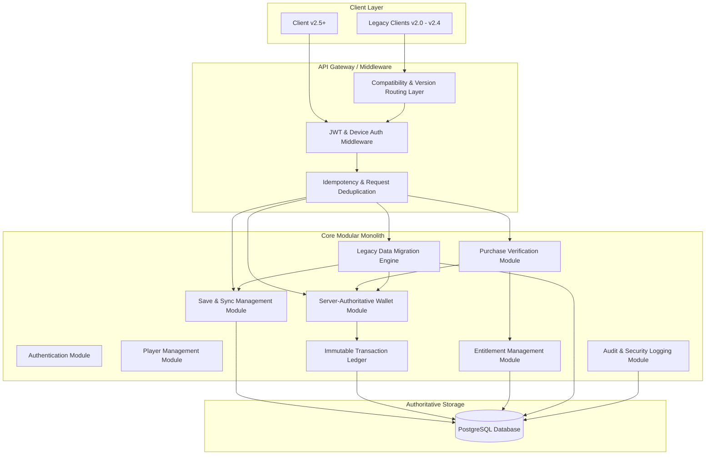

# Merge Kingdom 2.5 — Architecture & System Analysis

## 1. Executive Summary & Objective

**Merge Kingdom** is a live mobile puzzle game transitioning from version 2.4 to version 2.5. 
The core business driver is a fundamental change to the virtual economy mandated by Finance:
* **Coins:** Earned through gameplay only (levels, chests, in-game rewards).
* **Gems:** Purchased using real money only (IAP). The in-game store will sell items for gems.

### The Immutable Business Rule
> **"No player may lose progress, or anything that they paid for."** (Assignment PDF, Page 2)

This document establishes the system analysis of the existing live game (versions 2.0–2.4), identifies the architectural root causes of live bugs and customer support incidents, and specifies the version 2.5 server-authoritative modular monolith architecture.

---

## 2. In-Depth Analysis of the Live System (v2.0 – v2.4)

### 2.1 Existing Save Data & C# SaveSystem Analysis
*Source: Page 2 (Fact 1), Page 3 (Fact 2)*

```csharp
[Serializable]
public class Inventory {
    public int hammer;
    public int shuffle;
}

[Serializable]
public class SaveData {
    public string player_id;
    public long saved_at;
    public int level;
    public int coins;
    public Inventory inventory;
    public bool no_ads;
}
```

#### Critical Vulnerabilities in Existing Implementation:
1. **Unauthenticated, Client-Generated Timestamp (`saved_at`):**
   * *Evidence (Page 2, Fact 1; Page 3, Fact 2):* `Current.saved_at = DateTimeOffset.Now.ToUnixTimeSeconds();`
   * *Flaw:* `saved_at` is derived entirely from the mobile device's local system clock (`DateTimeOffset.Now`). Any manual modification of the phone's clock directly corrupts the distributed ordering of saves.
2. **Client-Authoritative State:**
   * *Evidence (Page 3, Fact 2):* The client writes directly to local storage (`File.WriteAllText(LocalPath, json)`) and asynchronously pushes the raw JSON snapshot to the server via `CloudSync.Upload(json)`.
   * *Flaw:* The client determines `level`, `coins`, `inventory`, and `no_ads`. The server is reduced to a passive, dumb key-value store.
3. **Monolithic Overwrites:**
   * The save payload is an all-or-nothing snapshot. Level progression, wallet balances, consumable inventory, and permanent entitlements (`no_ads`) are bundled into a single object. A conflict in level progression forcibly overwrites financial balances and entitlements.

---

### 2.2 Save, Load, and Cloud Synchronization Mechanics
*Source: Page 3 (Fact 2 & Fact 3)*

```csharp
public static void Load() {
    string json = File.ReadAllText(LocalPath);
    Current = JsonUtility.FromJson<SaveData>(json);
}

public static void Save() {
    Current.saved_at = DateTimeOffset.Now.ToUnixTimeSeconds();
    string json = JsonUtility.ToJson(Current);
    File.WriteAllText(LocalPath, json);
    CloudSync.Upload(json);
}

public static void OnCloudSave(string serverJson) {
    SaveData server = JsonUtility.FromJson<SaveData>(serverJson);
    if (server.saved_at > Current.saved_at) {
        Current = server;
        File.WriteAllText(LocalPath, serverJson);
    }
}
```

#### Analysis of Sync Rules:
* *Evidence (Page 3, Fact 3):* 
  1. *"The server keeps one save for each player. When an upload arrives, the server keeps it only if its saved_at is larger than the stored saved_at. The server does not read the other fields."*
  2. *"If the server keeps the upload, it sends it to the other devices of the player. If the server does not keep it, it sends its stored save back to the device that uploaded. On the device, both arrive through OnCloudSave."*
  3. *"When a device is offline, CloudSync.Upload keeps the upload in a queue and sends it when the device is online again."*

#### Core Failure Modes of this Protocol:
1. **Last-Write-Wins (LWW) Based on Untrusted Wall-Clock Time:** Because the server only evaluates `incoming.saved_at > stored.saved_at`, causality is completely decoupled from real-world sequence.
2. **Offline Queue Replay Stampede:** An offline device generates multiple saves with stale wall-clock times. When reconnected, queued uploads arrive at the server out of order or clobber progress made on an online device.
3. **Zero Semantic Merge Capability:** If Device A gains 100 coins and Device B completes Level 150, whichever save has a higher timestamp will wipe out either the earned coins or the beaten levels.

---

### 2.3 Historical Data & Information Asymmetry
*Source: Page 4 (Fact 4)*

* *"The server has a record of each coin pack that a player bought: player, pack, number of coins, time."*
* *"The server has no record of how players spent coins. Coins are spent on the phone."*

#### Critical Architectural Consequence:
There is an asymmetric audit trail. We know the **lifetime purchased coins** ($C_{purchased}$) for every player from billing/store transaction records. However, because coin deductions occurred entirely client-side without transaction logging:
* It is mathematically impossible to know whether a player's current remaining balance ($C_{current}$) consists of unspent purchased coins or unspent gameplay-earned coins.
* Any migration policy converting legacy coins to new coins/gems cannot rely on exact historical spend classification and must be governed by a transparent, legally defensible, and Finance-approved policy.

---

### 2.4 App Version Distribution & Ecosystem Constraints
*Source: Page 4 (Fact 5)*

| App Version | Share of Daily Players | Ecosystem / Operational Notes |
| :--- | :--- | :--- |
| **2.4 (latest)** | 58% | Current active target |
| **2.3** | 21% | Active live legacy |
| **2.2** | 11% | Active live legacy |
| **2.0 – 2.1** | 10% | **~50% of this cohort (~5% of total DAU) are on Android 7.** New builds do not support Android 7; they cannot update. |

#### Additional Operational Facts:
* **Multi-Device Usage:** ~9% of daily players actively used more than one device in the last 30 days. (Page 4, Fact 5)
* **Store Rollout Latency:** A new client build takes 3 to 7 days for app store review and rollout. (Page 4, Fact 5)
* **Forced Update Danger:** *"Our last forced update lost 18% of the players who saw the update screen."* (Page 4, Fact 5)

#### Key Takeaway:
We **cannot** perform a hard-kill forced update. Forcing an update would permanently wipe out at least ~5% of DAU (Android 7 players) and trigger an unacceptable ~18% churn rate across lagging versions. The backend **must** maintain backward compatibility for versions 2.0–2.4 alongside version 2.5.

---

### 2.5 Detailed Root-Cause Analysis of Customer Support Incidents
*Source: Page 4 (Fact 6)*

#### Incident 1: The Offline Overwrite / Multi-Device Conflict
> *"I played on my tablet all weekend and got to level 160. My son played on my old phone in airplane mode on Sunday night, after I stopped. Today I am back at level 151. Where did my levels go?"*

* **Step-by-Step Breakdown:**
  1. **Device A (Tablet):** Online all weekend. Player progresses to Level 160. Each level calls `Save()`, uploading `SaveData` with `level: 160` and `saved_at: T_weekend_Sunday_evening`. Server stores this save.
  2. **Device B (Phone):** In airplane mode (offline). The son plays on Sunday night. Local save is at Level 151.
  3. **The Offline Clock Anomaly:** While in airplane mode, the son plays *after* the tablet stopped. The phone local time is `T_phone_night > T_weekend_Sunday_evening`.
  4. **The Reconnection:** Monday morning, airplane mode is disabled on the phone.
  5. **Queue Flush:** `CloudSync.Upload` flushes the queued save (`level: 151`, `saved_at: T_phone_night`).
  6. **Server Processing:** Server checks `T_phone_night > T_server (T_weekend_Sunday_evening)`. Since it is larger, the server **keeps** the Level 151 save and overwrites Level 160 (Page 3, Fact 3).
  7. **Broadcast:** Server sends the Level 151 save to the tablet.
  8. **Tablet Overwrite:** Tablet receives `OnCloudSave(serverJson)`. Since `server.saved_at > Current.saved_at`, the tablet assigns `Current = server` and writes Level 151 to disk (Page 3, Fact 2).
* **Root Cause:** Naive timestamp LWW without progression monotonicity checks or semantic merge (Level 151 overwrote Level 160).

---

#### Incident 2: Clock Manipulation & Stale Rejection
> *"I changed the date on my phone to tomorrow, opened the free chest early and played one level. Then I changed the date back. Later I played more levels on the bus with no internet. When I got home, those levels were gone."*

* **Step-by-Step Breakdown:**
  1. **Clock Fast-Forward:** Player manually sets device clock to tomorrow (`T_future = Now + 86400s`).
  2. **Chest & Level Play:** Player plays one level. `Save()` executes: `Current.saved_at = T_future`.
  3. **Server Upload:** Device is online; uploads save with `saved_at: T_future`. Server accepts it because `T_future > T_stored`.
  4. **Clock Restored:** Player changes date back to actual time (`T_real`).
  5. **Offline Progression:** On the bus without internet, player beats multiple levels. Each call to `Save()` sets `Current.saved_at = DateTimeOffset.Now.ToUnixTimeSeconds()`, which evaluates to `T_real < T_future`. Local save has progressed levels, but timestamps are in the past relative to `T_future`.
  6. **Reconnection at Home:** When the device connects to Wi-Fi, `CloudSync.Upload` sends the latest local save (`saved_at: T_real`).
  7. **Server Rejection:** Server evaluates `incoming.saved_at (T_real) > stored.saved_at (T_future)`. This is **FALSE**.
  8. **Server Bounce-Back:** Per Fact 3: *"If the server does not keep it, it sends its stored save back to the device that uploaded."* Server returns the old save from tomorrow.
  9. **Client Overwrite:** Device receives `OnCloudSave`. Because `server.saved_at (T_future) > Current.saved_at (T_real)`, the client executes `Current = server; File.WriteAllText(LocalPath, serverJson);`.
* **Root Cause:** Trusting client clock. Future-dated timestamps permanently poison the player's account until real time passes the spoofed timestamp, reverting all subsequent valid progress.

---

#### Incident 3: Non-Authoritative Permanent Entitlement
> *"I paid for No Ads in March. Last week the ads came back. I play on my phone and on my old tablet."*

* **Step-by-Step Breakdown:**
  1. **Purchase on Phone (March):** Player purchases "No Ads" on Phone. In v2.4, `Current.no_ads = true; Save();`. Uploaded to server.
  2. **Dormant Tablet:** The player's old tablet has been powered off or inactive since before March, with `no_ads: false` and `saved_at: T_old`.
  3. **Tablet Launch & Play:** Last week, player opens the old tablet. The tablet loads local save (`no_ads: false`).
  4. **Race / Outdated Sync:** If the tablet plays a level before receiving `OnCloudSave`, or if the tablet was launched offline, its local clock updates to `T_now`. When it connects, if its `saved_at` exceeds the phone's last uploaded save, the server accepts the tablet's save.
  5. **Entitlement Loss:** The server blindly saves the payload without inspecting fields (`"The server does not read the other fields."`, Fact 3). The player's server state now has `no_ads: false`.
  6. **Propagation:** When the phone next connects, it receives `no_ads: false` via `OnCloudSave`, stripping the player of their paid purchase.
* **Root Cause:** Treating a durable, real-money entitlement (`no_ads`) as a mutable client-side flag embedded in an ephemeral save file rather than a server-authoritative account-level entitlement ledger.

---

## 3. Version 2.5 Architecture: Modular Monolith

To eliminate client vulnerabilities while remaining simple, maintainable, and free of unnecessary microservice overhead, Merge Kingdom 2.5 adopts a **Server-Authoritative Modular Monolith** built on **FastAPI** and **SQLAlchemy 2.0**.



### 3.1 Logical Module Responsibilities & Contracts

#### 1. Authentication Module (`app.modules.auth`)
* **Responsibilities:**
  * Issues cryptographically signed JWTs (`access_token`, `refresh_token`) based on verified `player_id` and registered `device_id`.
  * Verifies device hardware IDs and prevents identity spoofing.
* **Interactions:** Injected via FastAPI dependencies into all authenticated endpoints.

#### 2. Player Management Module (`app.modules.player`)
* **Responsibilities:**
  * Manages core player identity, account creation date, ban status, and linked devices.
  * Tracks multi-device registrations per player account.

#### 3. Save Management & Device Sync Module (`app.modules.save_sync`)
* **Responsibilities:**
  * **Eliminates client-clock LWW:** Replaces `saved_at` timestamp comparison with **monotonic revision counters (`revision_id`)** and server-generated timestamps (`server_timestamp_utc`).
  * Implements **Semantic 3-Way Merge**:
    * Level progress is strictly monotonic: `level = max(server.level, client.level)`.
    * Inventory items are merged safely (max or delta accumulation).
    * Entitlements (`no_ads`) are decoupled entirely and cannot be overwritten by save uploads.
  * Handles offline queue uploads safely by applying changes against the base revision the client branched from.

#### 4. Currency Wallet Module (`app.modules.wallet`)
* **Responsibilities:**
  * Holds server-authoritative balances for **Coins** (earned) and **Gems** (purchased).
  * **Strict Constraint:** Clients CANNOT directly write or set balances. Balances can only be altered through discrete atomic operations: `earn_coins`, `spend_coins`, `grant_gems`, `spend_gems`.
  * Enforces PostgreSQL row-level locking (`SELECT ... FOR UPDATE`) during all balance operations to prevent double-spending and race conditions.

#### 5. Transaction Ledger Module (`app.modules.ledger`)
* **Responsibilities:**
  * Implements an **append-only, immutable double-entry ledger** of every balance mutation.
  * Records: `transaction_id`, `player_id`, `currency_type` (`COIN` | `GEM`), `amount` (signed delta), `balance_before`, `balance_after`, `reason`, `idempotency_key`, and `created_at`.
* **Interactions:** Every Wallet operation MUST create a corresponding Ledger entry inside the same database transaction.

#### 6. Purchase Verification Module (`app.modules.purchase`)
* **Responsibilities:**
  * In-App Purchase (IAP) validation for Apple App Store (App Store Server API / JWS) and Google Play Billing (Google Play Developer API).
  * Validates transaction receipts, verifies product identifiers, ensures the purchase has not been previously claimed (re-play attack protection).
  * Dispatches credit operations to `Wallet` (for gem packs) or `Entitlement` (for `no_ads`).

#### 7. Entitlement Management Module (`app.modules.entitlement`)
* **Responsibilities:**
  * Manages durable, permanent player entitlements (e.g., `no_ads`, VIP passes).
  * Entitlements are tied to the `player_id`, stored server-side, and synchronized downward to all registered devices.
  * A client save payload can NEVER set an entitlement to `false`. Once granted, an entitlement remains active unless revoked via administrative action or verified store refund.

#### 8. Legacy Data Migration Module (`app.modules.migration`)
* **Responsibilities:**
  * Safely migrates players transitioning from v2.4 (single coin balance) to v2.5 (coins + gems).
  * Implements the defensible, idempotent conversion policy approved by Finance.
  * Records an immutable snapshot of pre-migration balances before applying mutations.

#### 9. Audit Logging Module (`app.modules.audit`)
* **Responsibilities:**
  * Records administrative actions, migration executions, suspicious clock deviations, and conflict resolutions for full operational visibility.

---

## 4. Key Architectural Decisions & Trade-Offs

### Decision 1: Monotonic Revisions vs. Client Timestamps
* **Decision:** Completely abandon `saved_at` as the source of sync ordering. Every save state on the server is assigned a monotonically increasing `revision_id` (integer).
* **Rationale:** Client clocks are trivial to modify (as demonstrated in Support Incident 2) and drift naturally across hardware. Monotonic revision tracking ensures deterministic concurrency control (optimistic concurrency control).

### Decision 2: Decoupling Entitlements & Wallet from Save Blobs
* **Decision:** The game save payload will only contain pure gameplay progression (board state, current level, puzzle tile configuration). Wallet balances and entitlements are stored in first-class, normalized database tables.
* **Rationale:** Resolves Support Incident 3. An outdated device restoring a save cannot inadvertently revoke a paid purchase or downgrade wallet balances.

### Decision 3: Backward Compatibility Adapter Layer
* **Decision:** The backend provides a legacy ingestion pipeline for versions 2.0–2.4. When an old client uploads a v2.4 save, the adapter translates the request, applies progression rules, protects entitlements, and converts the legacy coin field safely.
* **Rationale:** Protects the ~5% of daily players on Android 7 who cannot upgrade to v2.5, and prevents the 18% player churn observed during forced update screens.
