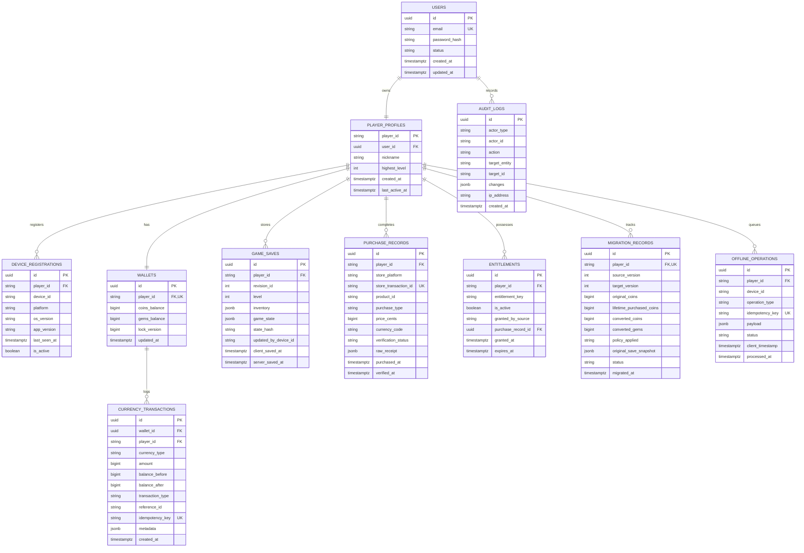

# Merge Kingdom 2.5 — PostgreSQL Database Design

## 1. Design Principles & Data Integrity

1. **Server-Authoritative Normalization:**
   * Pure gameplay state (`level`, `board_state`, `inventory`) is decoupled from financial data (`wallets`, `currency_transactions`) and permanent entitlements (`entitlements`).
2. **Immutable Double-Entry Ledger:**
   * Wallet balances are backed by an append-only transaction ledger. A balance represents the current snapshot of all historical ledger debits and credits.
3. **Smallest-Unit Integer Precision:**
   * All currency and monetary values are stored as 64-bit integers (`BIGINT`). No floating-point math is used for real-money costs (cents) or virtual currency units (coins, gems).
4. **Strict Concurrency Control:**
   * Balance modifications employ row-level locking (`SELECT ... FOR UPDATE`) inside standard ACID transactions at `READ COMMITTED` isolation level, preventing lost updates and race-condition double-spending.
   * Save updates use Optimistic Concurrency Control (OCC) through monotonically increasing `revision_id` counters.
5. **Idempotency by Design:**
   * Financial transactions, purchase verifications, and offline sync operations enforce unique constraint checking on client-supplied idempotency keys or app-store transaction IDs.

---

## 2. Entity-Relationship Model (Mermaid ERD)



---

## 3. Relational Schema Definitions (PostgreSQL DDL)

### 3.1 Users and Player Profiles
```sql
CREATE TABLE users (
    id UUID PRIMARY KEY DEFAULT gen_random_uuid(),
    email VARCHAR(255) UNIQUE,
    password_hash VARCHAR(255),
    status VARCHAR(32) NOT NULL DEFAULT 'ACTIVE', -- ACTIVE, SUSPENDED, BANNED
    created_at TIMESTAMPTZ NOT NULL DEFAULT CURRENT_TIMESTAMP,
    updated_at TIMESTAMPTZ NOT NULL DEFAULT CURRENT_TIMESTAMP
);

CREATE TABLE player_profiles (
    player_id VARCHAR(64) PRIMARY KEY, -- e.g. 'p_8812'
    user_id UUID REFERENCES users(id) ON DELETE SET NULL,
    nickname VARCHAR(64),
    highest_level INT NOT NULL DEFAULT 1,
    created_at TIMESTAMPTZ NOT NULL DEFAULT CURRENT_TIMESTAMP,
    last_active_at TIMESTAMPTZ NOT NULL DEFAULT CURRENT_TIMESTAMP
);

CREATE INDEX idx_player_profiles_user_id ON player_profiles(user_id);
```

### 3.2 Device Registrations
```sql
CREATE TABLE device_registrations (
    id UUID PRIMARY KEY DEFAULT gen_random_uuid(),
    player_id VARCHAR(64) NOT NULL REFERENCES player_profiles(player_id) ON DELETE CASCADE,
    device_id VARCHAR(128) NOT NULL,
    platform VARCHAR(32) NOT NULL, -- iOS, Android
    os_version VARCHAR(64) NOT NULL, -- e.g. "Android 7.0", "iOS 17.4"
    app_version VARCHAR(32) NOT NULL, -- e.g. "2.4", "2.5"
    last_seen_at TIMESTAMPTZ NOT NULL DEFAULT CURRENT_TIMESTAMP,
    is_active BOOLEAN NOT NULL DEFAULT TRUE,
    CONSTRAINT uq_player_device UNIQUE (player_id, device_id)
);

CREATE INDEX idx_device_player_active ON device_registrations(player_id, is_active);
CREATE INDEX idx_device_platform_os ON device_registrations(platform, os_version);
```

### 3.3 Game Saves & Concurrency Control
```sql
CREATE TABLE game_saves (
    id UUID PRIMARY KEY DEFAULT gen_random_uuid(),
    player_id VARCHAR(64) NOT NULL REFERENCES player_profiles(player_id) ON DELETE CASCADE,
    revision_id INT NOT NULL DEFAULT 1, -- Monotonically increasing revision counter
    level INT NOT NULL CHECK (level >= 1),
    inventory JSONB NOT NULL DEFAULT '{"hammer": 0, "shuffle": 0}'::jsonb,
    game_state JSONB NOT NULL DEFAULT '{}'::jsonb, -- Board layout, tile positions
    state_hash VARCHAR(64) NOT NULL, -- SHA-256 integrity hash
    updated_by_device_id VARCHAR(128) NOT NULL,
    client_saved_at TIMESTAMPTZ NOT NULL, -- Device clock (recorded for audit only)
    server_saved_at TIMESTAMPTZ NOT NULL DEFAULT CURRENT_TIMESTAMP, -- Authoritative time
    is_latest BOOLEAN NOT NULL DEFAULT TRUE,
    CONSTRAINT uq_player_revision UNIQUE (player_id, revision_id)
);

CREATE UNIQUE INDEX uq_player_latest_save ON game_saves(player_id) WHERE is_latest = TRUE;
CREATE INDEX idx_game_saves_player_rev ON game_saves(player_id, revision_id DESC);
```

### 3.4 Wallets & Double-Entry Currency Ledger
```sql
CREATE TABLE wallets (
    id UUID PRIMARY KEY DEFAULT gen_random_uuid(),
    player_id VARCHAR(64) NOT NULL UNIQUE REFERENCES player_profiles(player_id) ON DELETE CASCADE,
    coins_balance BIGINT NOT NULL DEFAULT 0 CHECK (coins_balance >= 0),
    gems_balance BIGINT NOT NULL DEFAULT 0 CHECK (gems_balance >= 0),
    lock_version BIGINT NOT NULL DEFAULT 0, -- Optimistic concurrency lock
    updated_at TIMESTAMPTZ NOT NULL DEFAULT CURRENT_TIMESTAMP
);

CREATE TABLE currency_transactions (
    id UUID PRIMARY KEY DEFAULT gen_random_uuid(),
    wallet_id UUID NOT NULL REFERENCES wallets(id) ON DELETE RESTRICT,
    player_id VARCHAR(64) NOT NULL REFERENCES player_profiles(player_id) ON DELETE CASCADE,
    currency_type VARCHAR(16) NOT NULL CHECK (currency_type IN ('COIN', 'GEM')),
    amount BIGINT NOT NULL, -- Positive for credit, negative for debit
    balance_before BIGINT NOT NULL CHECK (balance_before >= 0),
    balance_after BIGINT NOT NULL CHECK (balance_after >= 0),
    transaction_type VARCHAR(32) NOT NULL, -- LEVEL_REWARD, CHEST_REWARD, IAP_GRANT, STORE_SPEND, MIGRATION_CONVERSION, ADMIN_ADJUSTMENT
    reference_id VARCHAR(128), -- Links to level_id, product_id, or iap_transaction_id
    idempotency_key VARCHAR(128) UNIQUE, -- Protects against client duplicate retries
    metadata JSONB NOT NULL DEFAULT '{}'::jsonb,
    created_at TIMESTAMPTZ NOT NULL DEFAULT CURRENT_TIMESTAMP
);

CREATE INDEX idx_currency_tx_player_time ON currency_transactions(player_id, created_at DESC);
CREATE INDEX idx_currency_tx_type ON currency_transactions(transaction_type);
```

### 3.5 Purchase Records & In-App Purchase Verification
```sql
CREATE TABLE purchase_records (
    id UUID PRIMARY KEY DEFAULT gen_random_uuid(),
    player_id VARCHAR(64) NOT NULL REFERENCES player_profiles(player_id) ON DELETE CASCADE,
    store_platform VARCHAR(32) NOT NULL CHECK (store_platform IN ('GOOGLE_PLAY', 'APPLE_APP_STORE', 'LEGACY_MIGRATED')),
    store_transaction_id VARCHAR(255) NOT NULL UNIQUE, -- Store order ID / JWS transaction ID
    product_id VARCHAR(128) NOT NULL, -- e.g. "gems_pack_tier_1", "no_ads_bundle"
    purchase_type VARCHAR(32) NOT NULL CHECK (purchase_type IN ('CURRENCY', 'ENTITLEMENT', 'HYBRID')),
    price_cents BIGINT NOT NULL DEFAULT 0,
    currency_code VARCHAR(8) NOT NULL DEFAULT 'USD',
    verification_status VARCHAR(32) NOT NULL CHECK (verification_status IN ('VERIFIED', 'FAILED', 'REFUNDED', 'LEGACY')),
    raw_receipt JSONB,
    purchased_at TIMESTAMPTZ NOT NULL,
    verified_at TIMESTAMPTZ NOT NULL DEFAULT CURRENT_TIMESTAMP
);

CREATE INDEX idx_purchase_player_time ON purchase_records(player_id, purchased_at DESC);
CREATE INDEX idx_purchase_store_tx ON purchase_records(store_transaction_id);
```

### 3.6 Entitlements Management
```sql
CREATE TABLE entitlements (
    id UUID PRIMARY KEY DEFAULT gen_random_uuid(),
    player_id VARCHAR(64) NOT NULL REFERENCES player_profiles(player_id) ON DELETE CASCADE,
    entitlement_key VARCHAR(64) NOT NULL, -- e.g. 'no_ads', 'vip_season_1'
    is_active BOOLEAN NOT NULL DEFAULT TRUE,
    granted_by_source VARCHAR(64) NOT NULL, -- 'IAP_PURCHASE', 'LEGACY_SAVE_RESTORE', 'ADMIN_SUPPORT'
    purchase_record_id UUID REFERENCES purchase_records(id) ON DELETE SET NULL,
    granted_at TIMESTAMPTZ NOT NULL DEFAULT CURRENT_TIMESTAMP,
    expires_at TIMESTAMPTZ, -- NULL for permanent entitlements like No Ads
    CONSTRAINT uq_player_entitlement UNIQUE (player_id, entitlement_key)
);

CREATE INDEX idx_entitlements_active ON entitlements(player_id, is_active);
```

### 3.7 Legacy Migration Records
```sql
CREATE TABLE migration_records (
    id UUID PRIMARY KEY DEFAULT gen_random_uuid(),
    player_id VARCHAR(64) NOT NULL UNIQUE REFERENCES player_profiles(player_id) ON DELETE CASCADE,
    source_version VARCHAR(16) NOT NULL DEFAULT '2.4',
    target_version VARCHAR(16) NOT NULL DEFAULT '2.5',
    original_coins BIGINT NOT NULL,
    lifetime_purchased_coins BIGINT NOT NULL DEFAULT 0,
    converted_coins BIGINT NOT NULL,
    converted_gems BIGINT NOT NULL,
    policy_applied VARCHAR(64) NOT NULL, -- 'PURCHASED_FIRST_PROTECTION'
    original_save_snapshot JSONB NOT NULL,
    status VARCHAR(32) NOT NULL CHECK (status IN ('PENDING', 'COMPLETED', 'FAILED', 'ROLLED_BACK')),
    migrated_at TIMESTAMPTZ NOT NULL DEFAULT CURRENT_TIMESTAMP
);
```

### 3.8 Offline Operations Queue & Audit Logs
```sql
CREATE TABLE offline_operations (
    id UUID PRIMARY KEY DEFAULT gen_random_uuid(),
    player_id VARCHAR(64) NOT NULL REFERENCES player_profiles(player_id) ON DELETE CASCADE,
    device_id VARCHAR(128) NOT NULL,
    operation_type VARCHAR(64) NOT NULL, -- 'LEVEL_COMPLETE', 'ITEM_USE', 'CHEST_OPEN'
    idempotency_key VARCHAR(128) NOT NULL UNIQUE,
    payload JSONB NOT NULL,
    status VARCHAR(32) NOT NULL DEFAULT 'PENDING' CHECK (status IN ('PENDING', 'APPLIED', 'REJECTED')),
    client_timestamp TIMESTAMPTZ NOT NULL,
    processed_at TIMESTAMPTZ
);

CREATE TABLE audit_logs (
    id UUID PRIMARY KEY DEFAULT gen_random_uuid(),
    actor_type VARCHAR(32) NOT NULL, -- 'SYSTEM', 'ADMIN', 'CLIENT'
    actor_id VARCHAR(128) NOT NULL,
    action VARCHAR(64) NOT NULL,
    target_entity VARCHAR(64) NOT NULL,
    target_id VARCHAR(128) NOT NULL,
    changes JSONB NOT NULL DEFAULT '{}'::jsonb,
    ip_address VARCHAR(45),
    created_at TIMESTAMPTZ NOT NULL DEFAULT CURRENT_TIMESTAMP
);

CREATE INDEX idx_audit_target ON audit_logs(target_entity, target_id);
CREATE INDEX idx_audit_time ON audit_logs(created_at DESC);
```

---

## 4. Transaction Isolation and Concurrency Guarantees

### Balance Mutation Lock Pattern (PostgreSQL / SQLAlchemy 2.0)
To prevent race conditions, currency mutations must adhere to this exact execution pattern:
```python
async with session.begin():
    # 1. Lock the wallet row exclusively
    wallet = await session.execute(
        select(Wallet)
        .where(Wallet.player_id == player_id)
        .with_for_update()
    ).scalar_one()

    # 2. Check sufficient balance
    if wallet.gems_balance + amount < 0:
        raise InsufficientFundsException()

    # 3. Create immutable ledger entry
    ledger_entry = CurrencyTransaction(
        wallet_id=wallet.id,
        player_id=player_id,
        currency_type="GEM",
        amount=amount,
        balance_before=wallet.gems_balance,
        balance_after=wallet.gems_balance + amount,
        idempotency_key=idempotency_key,
        transaction_type=tx_type,
    )
    session.add(ledger_entry)

    # 4. Mutate wallet snapshot
    wallet.gems_balance += amount
    wallet.lock_version += 1
```
This guarantees strict serializability per player wallet without table-level locking bottlenecks.
