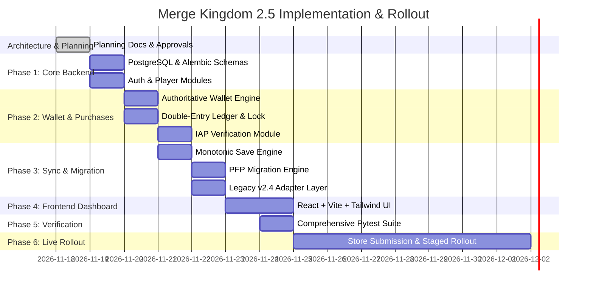

# Merge Kingdom 2.5 — Implementation Roadmap & Rollout Plan

## 1. Project Phase Breakdown

To deliver a reliable prototype and production rollout plan without introducing unnecessary complexity, the project is structured across 6 phases.

---

## 2. Phase Deliverables & Implementation Checklist

### Phase 1: Core Foundation & Data Modeling
* [ ] Setup FastAPI project structure with strict dependency injection.
* [ ] Configure SQLAlchemy 2.0 async engine and Alembic migrations.
* [ ] Implement core entities: `User`, `PlayerProfile`, `DeviceRegistration`.
* [ ] Device login and JWT issuance (`/auth/device-login`).

### Phase 2: Currency Wallet, Ledger & Purchase Verification
* [ ] Implement `Wallet` entity with `SELECT ... FOR UPDATE` row locking.
* [ ] Implement append-only `CurrencyTransaction` double-entry ledger.
* [ ] Build `/wallet/spend` and `/wallet/earn-coins` with idempotency controls.
* [ ] Implement `PurchaseRecord` and store receipt verification engine.
* [ ] Implement `Entitlement` management (No Ads decoupling).

### Phase 3: Monotonic Save Synchronization & Migration Engine
* [ ] Build `/saves/sync` using monotonic `revision_id` and semantic merge rules.
* [ ] Eliminate timestamp-based LWW overwrites.
* [ ] Implement the **Purchased-First Protection (PFP)** migration engine.
* [ ] Build `/legacy/sync` adapter for seamless v2.0–v2.4 compatibility.

### Phase 4: Customer Support & Live Monitoring Dashboard (React + Vite)
* [ ] Initialize React + Vite + Tailwind CSS dashboard in `frontend/`.
* [ ] **Player Inspector:** View player save revision, level, coins, gems, devices, and entitlements.
* [ ] **Incident Simulator:** Reproduce and visualize Support Incidents 1, 2, and 3 in real time.
* [ ] **Migration Simulator:** Test PFP conversion on sample player profiles and verify audit logs.
* [ ] **Live Ledger Explorer:** Real-time stream of wallet credits, debits, and store purchases.

### Phase 5: Automated Testing & Chaos Verification
* [ ] Replicate all 3 support incidents in Pytest tests.
* [ ] High-concurrency double-spending verification (20 simultaneous spend calls).
* [ ] IAP verification idempotency tests.
* [ ] Migration idempotency and rollback tests.
* [ ] Old-client (v2.0 – v2.4) backward compatibility tests.

---

## 3. Live Release & Rollout Strategy

### 3.1 Store Review Buffer & Staged Rollout Schedule
* *Fact 5 (Page 4):* A new build takes 3 to 7 days for store review and rollout.
* *Rollout Schedule:*
  * **Day -7 to Day 0:** Deploy backend v2.5 to production. Backend operates in dual-mode (serving v2.0–v2.4 traffic via `/legacy/sync` while ready for v2.5).
  * **Day 0:** Submit v2.5 client builds to Google Play and Apple App Store.
  * **Day 3 (Approval):** Release to **1% of daily active users** (staged rollout).
  * **Day 4:** Expand to **5% of DAU**. Monitor migration logs, store error rates, and support tickets.
  * **Day 5:** Expand to **20% of DAU**.
  * **Day 6:** Expand to **50% of DAU**.
  * **Day 7:** Expand to **100% of DAU** for all compatible OS versions.

---

### 3.2 Mitigation for Forced Update Churn & Android 7 Players
* *Fact 5 (Page 4):* 
  * *"Our last forced update lost 18% of the players who saw the update screen."*
  * *"10% of daily players are on versions 2.0–2.1. About half (~5% of total DAU) are on Android 7. New builds do not support Android 7, so they cannot update."*
* **Policy Mandate:**
  1. **NO Hard Forced Updates:** We will **not** display a blocking forced-update dialog.
  2. **Soft In-Game Prompt:** Compatible devices (Android 8+, iOS) receive a dismissible banner highlighting the new Gem Store and new content.
  3. **Permanent Legacy Compatibility:** The backend `/legacy/sync` adapter will remain permanently operational to serve Android 7 players, allowing them to continue playing Merge Kingdom without disruption or data loss.

---

## 4. Operational Monitoring, Alerting & Rollback Triggers

### Real-Time Metric Thresholds
1. **Migration Failure Rate:** Alert if migration failure exceeds **0.01%** of requests.
2. **Double-Spend Attempts / 409s:** Alert if conflict rate exceeds **2.0%** of save syncs.
3. **Negative Balance Anomaly:** Immediate pager duty if any wallet balance drops below 0.
4. **App Store Review Latency:** Track store review queues daily.

### Rollback Strategy
* If a critical flaw is discovered during the staged rollout:
  1. Pause Google Play staged rollout immediately in the Google Play Console.
  2. Toggle backend feature flag `MIGRATION_PAUSED=true` to suspend new coin-to-gem conversions.
  3. Existing v2.5 players continue using their current save; legacy players continue on v2.4.
  4. Run automated migration rollback script for any corrupted player accounts using `migration_records.original_save_snapshot`.
