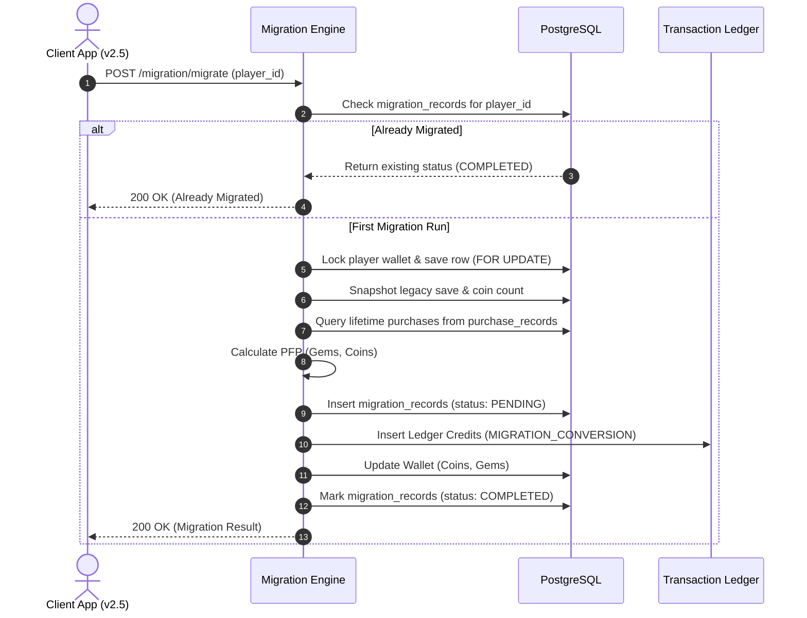

# Merge Kingdom 2.5 — Legacy Migration Policy & Financial Analysis

## 1. The Core Problem: Missing Coin Spending History

### Fact Verification from Assignment PDF
* **Fact 4 (Page 4):**
  > *"The server has a record of each coin pack that a player bought: player, pack, number of coins, time. The server has no record of how players spent coins. Coins are spent on the phone."*
* **The Rule (Page 2):**
  > *"No player may lose progress, or anything that they paid for."*

### The Mathematical Impossibility of Exact Reconstruction
Let:
* $C_{\text{purchased}}$ = Lifetime coins purchased by the player via real-money IAP (known from server transaction records).
* $C_{\text{current}}$ = Current coin balance in the player's v2.4 save file (known at migration time).
* $C_{\text{earned}}$ = Total coins earned via gameplay (unknown on server).
* $C_{\text{spent}}$ = Total coins spent on boosters/moves (unknown on server).

Because $C_{\text{current}} = (C_{\text{purchased}} + C_{\text{earned}}) - C_{\text{spent}}$, and neither $C_{\text{earned}}$ nor $C_{\text{spent}}$ were recorded by the server, it is **mathematically impossible to determine the original monetary origin of any individual coin in $C_{\text{current}}$**.

Any migration approach is therefore a **business policy choice**, not a technical formula derived from historical fact.

---

## 2. Evaluation of Candidate Conversion Policies

| Policy Candidate | Formula | Pros | Cons & Financial Risks | Rule Compliance |
| :--- | :--- | :--- | :--- | :--- |
| **Option A: 100% Gem Conversion** | $\text{Gems} = C_{\text{current}}$ $\text{Coins} = 0$ | High player delight. Zero risk of losing paid value. | **Catastrophic financial loss.** Grants paid gems for billions of freely earned gameplay coins. Destroys v2.5 IAP revenue. | Passes rule, fails business viability. |
| **Option B: 0% Gem Conversion** | $\text{Gems} = 0$ $\text{Coins} = C_{\text{current}}$ | Zero revenue cannibalization. | **Violates the Rule.** Players who recently purchased coin packs and haven't spent them lose their paid currency. Massive chargebacks and store bans. | **FAILS RULE.** |
| **Option C: Proportional Ratio** | Ratio = $\frac{C_{\text{purchased}}}{C_{\text{purchased}} + \text{Estimated Earned}}$ | Mathematically elegant. | Requires fabricating unrecorded "Estimated Earned" coins. If player bought 1,000 coins and holds 1,000 coins, gives them <1,000 gems, violating the rule. | High dispute risk. |
| **Option D: Purchased-First Protection (PFP)** *(Recommended)* | $\text{Gems} = \min(C_{\text{current}}, C_{\text{purchased}})$ $\text{Coins} = C_{\text{current}} - \text{Gems}$ | 100% compliant with rule. Protects every paid coin up to current balance. Zero arbitrary estimation. | Small financial cost: assumes players spent free coins before spent purchased coins. | **FULLY COMPLIANT.** |

---

## 3. Recommended Policy: Purchased-First Protection (PFP)

### Policy Definition
1. Check the server purchase database for the player's lifetime purchased coins: $C_{\text{purchased}} = \sum \text{pack\_coins}$.
2. If $C_{\text{purchased}} = 0$ (Pure F2P player):
   * $\text{Coins}_{2.5} = C_{\text{current}}$
   * $\text{Gems}_{2.5} = 0$
3. If $C_{\text{purchased}} > 0$:
   * $\text{Gems}_{2.5} = \min(C_{\text{current}}, C_{\text{purchased}})$
   * $\text{Coins}_{2.5} = C_{\text{current}} - \text{Gems}_{2.5}$
4. **Exchange Rate Assumption:** 1 legacy coin bought = 1 gem in version 2.5 (unless Finance mandates a calibrated gem peg, e.g. 10 coins = 1 gem). For clarity in these formulas, 1:1 unit equivalence is assumed.

---

## 4. Persona Walkthroughs & Economic Impact

### Player 1: "The Whale / Active Spender"
* **Profile:** Bought 10,000 coins across 3 packs ($C_{\text{purchased}} = 10,000$). Heavily spent on tough levels. Currently holds 2,500 coins in save ($C_{\text{current}} = 2,500$).
* **PFP Conversion:**
  * $\text{Gems} = \min(2500, 10000) = 2,500\text{ gems}$.
  * $\text{Coins} = 2500 - 2500 = 0\text{ coins}$.
* **Analysis:**
  * *Did they lose anything paid for?* No. They are credited 2,500 gems for every single coin currently in their purse.
  * *Who gains / loses?* The player gains maximum financial protection. The studio incurs a minor cost by treating their remaining coins as purchased rather than earned.

### Player 2: "The F2P Grinder with a Starter Bundle"
* **Profile:** Reached level 150. Earned 12,000 coins through play. Bought one 500-coin starter pack ($C_{\text{purchased}} = 500$). Currently holds 4,000 coins ($C_{\text{current}} = 4,000$).
* **PFP Conversion:**
  * $\text{Gems} = \min(4000, 500) = 500\text{ gems}$.
  * $\text{Coins} = 4000 - 500 = 3,500\text{ coins}$.
* **Analysis:**
  * *Did they lose anything paid for?* No. All 500 purchased coins are fully converted into premium gems.
  * *Did they lose gameplay progress?* No. Their remaining 3,500 coins remain playable coins in v2.5.
  * *Who gains / loses?* Fair outcome. Player keeps paid gems and earned coins.

### Player 3: "The Pure Free-to-Play Player"
* **Profile:** Lifetime purchases = \$0 ($C_{\text{purchased}} = 0$). Current coins = 6,200.
* **PFP Conversion:**
  * $\text{Gems} = 0$.
  * $\text{Coins} = 6,200$.
* **Analysis:**
  * Perfectly preserves progress. Zero revenue dilution for the studio.

---

## 5. Idempotency, Safety, and Rollback Design

Migration is a high-risk operation on live player data. The migration engine must guarantee:

### Safety Requirements
1. **Immutable Snapshot:** The original v2.4 JSON payload is serialized into `migration_records.original_save_snapshot` before any balance mutations occur.
2. **Re-Run Safety:** A unique constraint on `migration_records(player_id)` prevents accidental double-execution. Repeated calls return the original migration receipt.
3. **Reversibility:** An administrative script can revert the wallet balances to `original_coins` and restore the v2.4 snapshot using the audit trail.

---

## 6. Decisions Requiring Formal Product & Finance Sign-Off

The engineering architecture supports configurable parameters. The following specific business decisions **must** be formally approved by Product and Finance leadership prior to live execution:

| Decision Item | Engineering Proposal | Alternatives Requiring Business Decision | Stakeholder |
| :--- | :--- | :--- | :--- |
| **Coin-to-Gem Peg Rate** | 1 purchased coin = 1 gem | If gem store prices differ from coin store prices (e.g. 100 coins vs 10 gems for a hammer), a conversion ratio (e.g. 10:1) must be defined. | Finance |
| **Goodwill / F2P Gem Grant** | 0 gems for F2P players | Granting 50–100 free gems to all players to introduce the new gem store and celebrate the v2.5 launch. | Product / Marketing |
| **Minimum Balance Floor** | Preserve exact calculated balance | Ensuring every migrated player has at least 100 coins to avoid early-session stall. | Game Design |
| **Sunset Threshold for Inactive v2.4 Accounts** | Migrate on next login (Lazy Migration) | Bulk batch migration vs. just-in-time migration upon app launch. | Finance / Ops |
