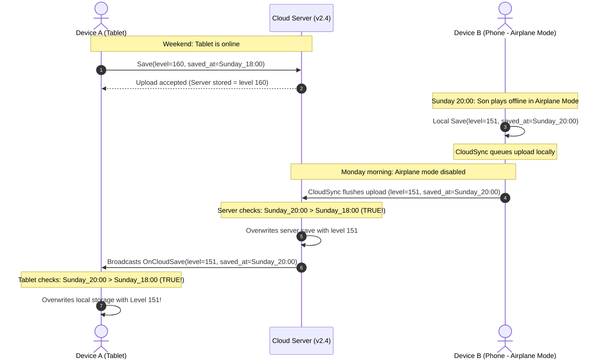
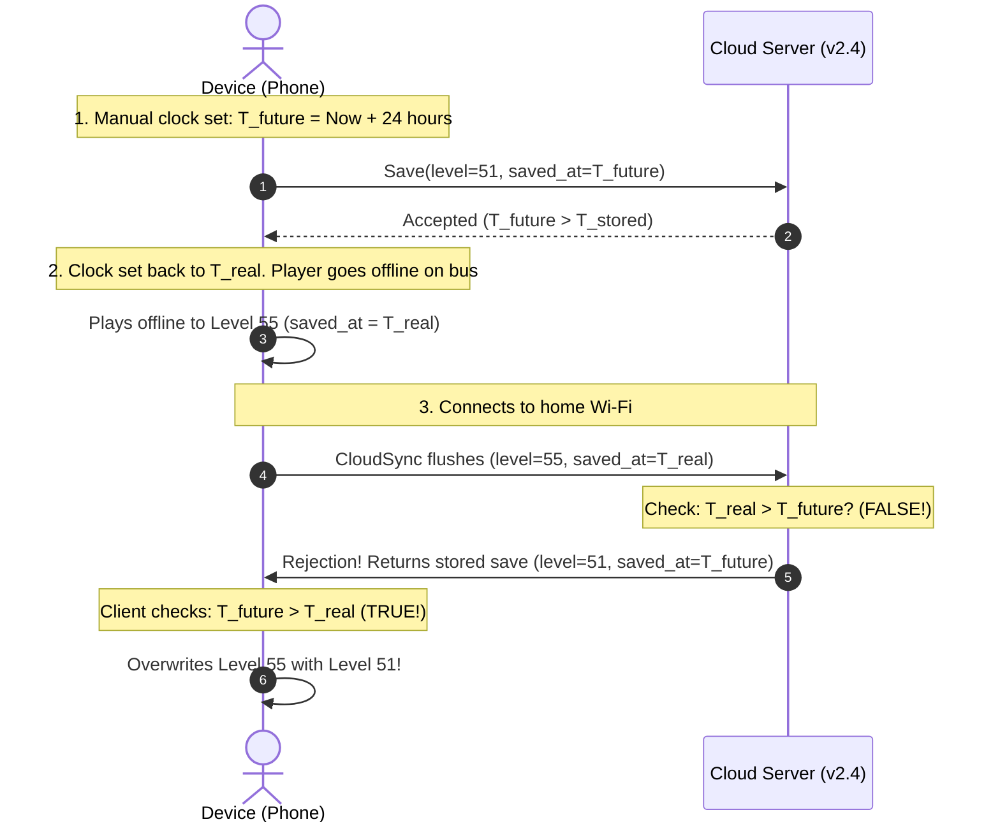

# Chaos Engine Labs — AI Engineer Take-Home Assignment
**Candidate Submission: Merge Kingdom 2.5 Migration & Systems Architecture**

---

## Task 1: Existing System Analysis (v2.0 – v2.4)

### 1.1 Architecture & Save Mechanics
*Reference: Assignment PDF, Page 2 (Fact 1), Page 3 (Fact 2 & 3)*

In Merge Kingdom versions 2.0 through 2.4, the client application operates as a client-authoritative system with an ephemeral, passive cloud synchronization layer. The core save object (`SaveData`) and sync routines in the Unity/C# client are structured as follows:

```csharp
[Serializable]
public class Inventory {
    public int hammer;
    public int shuffle;
}

[Serializable]
public class SaveData {
    public string player_id;
    public long saved_at;
    public int level;
    public int coins;
    public Inventory inventory;
    public bool no_ads;
}
```

The runtime synchronization lifecycle operates across three primary functions:
1. **`SaveSystem.Load()`:** Reads the local JSON file from disk into memory (`Current = JsonUtility.FromJson<SaveData>(json)`).
2. **`SaveSystem.Save()`:** Sets `Current.saved_at = DateTimeOffset.Now.ToUnixTimeSeconds()`, writes the local JSON file, and dispatches the raw JSON snapshot to the server via `CloudSync.Upload(json)`.
3. **`SaveSystem.OnCloudSave(serverJson)`:** When a server payload arrives, it deserializes the server state and compares timestamps:
   ```csharp
   if (server.saved_at > Current.saved_at) {
       Current = server;
       File.WriteAllText(LocalPath, serverJson);
   }
   ```

### 1.2 Structural Deficiencies & Failure Modes

#### A. Unauthenticated Wall-Clock Ordering (`saved_at`)
* *Evidence (Page 2 Fact 1, Page 3 Fact 2 & 3):* The distributed ordering of saves relies entirely on `DateTimeOffset.Now.ToUnixTimeSeconds()`. 
* *Systemic Flaw:* A mobile device's system clock is completely untrusted. Operating system clocks drift, hardware clocks desynchronize across devices, and users routinely modify their device time (e.g. to bypass time-gated mechanics). When the cloud synchronization logic uses client wall-clock time as its sole ordering primitive, causality is broken. A save generated with a future clock permanently poisons the player's account.

#### B. Monolithic Whole-Save Overwrite
* *Evidence (Page 3 Fact 3):* *"The server keeps one save for each player. When an upload arrives, the server keeps it only if its saved_at is larger than the stored saved_at. The server does not read the other fields."*
* *Systemic Flaw:* The save payload couples three completely orthogonal concerns into a single JSON blob:
  1. **Gameplay progression:** Current level reached and board state.
  2. **Virtual economy balances:** Single `coins` integer.
  3. **Permanent entitlements:** `no_ads` boolean flag.
  Because the server performs blind, last-write-wins (LWW) replacement based on `saved_at`, a conflict or rollback in one domain forcibly clobbers the others.

#### C. Asymmetric Auditing & Missing Coin Spend History
* *Evidence (Page 4, Fact 4):* *"The server has a record of each coin pack that a player bought: player, pack, number of coins, time. The server has no record of how players spent coins. Coins are spent on the phone."*
* *Systemic Flaw:* In v2.4, coin deductions for boosters (`hammer`, `shuffle`) were executed entirely in memory on the device and saved locally. The server only audited credits (in-app purchases of coin packs) and received periodic net coin balances. Because no ledger of debits exists, the exact monetary provenance of a player's remaining coins cannot be mathematically reconstructed.

#### D. Entitlement Fragility
* *Evidence (Page 3 Fact 2, Page 4 Fact 6 Incident 3):* Real-money permanent purchases (`no_ads`) are stored as a mutable client boolean (`public bool no_ads;`). If a secondary, dormant device connects with `no_ads: false` and a higher timestamp, the server overwrites the account state, revoking the player's paid purchase.

---

## Task 2: Root-Cause Analysis of Customer Support Incidents

*Reference: Assignment PDF, Page 4 (Fact 6)*

### Incident 1: The Multi-Device Offline Overwrite
> *"I played on my tablet all weekend and got to level 160. My son played on my old phone in airplane mode on Sunday night, after I stopped. Today I am back at level 151. Where did my levels go?"*



* **Step-by-Step Breakdown:**
  1. The mother plays on Device A (Tablet) online throughout the weekend, completing levels up to Level 160. Each completion calls `Save()`, setting `saved_at` to the current Sunday afternoon timestamp ($T_{\text{tablet}} = 1761700000$). The server stores this save.
  2. Sunday night, the son takes Device B (Phone), enables Airplane Mode, and plays from an outdated local save (Level 150) up to Level 151.
  3. When `Save()` executes on Device B, its local clock records Sunday night ($T_{\text{phone}} = 1761707200$). Because $T_{\text{phone}} > T_{\text{tablet}}$, this offline save has a strictly higher timestamp. Per Fact 3: *"When a device is offline, CloudSync.Upload keeps the upload in a queue and sends it when the device is online again."*
  4. On Monday, Airplane Mode is disabled. The phone flushes its queued save (`level: 151`, `saved_at: 1761707200`).
  5. The server evaluates: `incoming.saved_at > stored.saved_at` ($1761707200 > 1761700000$). This evaluates to **TRUE**.
  6. The server blindly accepts Level 151 and pushes it to Device A via `OnCloudSave`.
  7. Device A checks `server.saved_at > Current.saved_at`. This is **TRUE**. Device A overwrites Level 160 with Level 151.
* **Why the System Behaved This Way:** The server did not validate progression monotonicity ($\text{level}$ decreased from 160 to 151) and blindly executed LWW based on client timestamps.
* **Prevention in v2.5:**
  * Replaces client timestamps with **monotonic server revisions (`revision_id`)**.
  * Implements **semantic 3-way merge**: Level progression is strictly monotonic:
    $$\text{level}_{\text{resolved}} = \max(\text{server.level}, \text{client.level})$$
  * When the phone flushes its queue, the server detects a stale base revision, applies the merge rule, and preserves Level 160.

---

### Incident 2: Clock Tampering & Future Poisoning
> *"I changed the date on my phone to tomorrow, opened the free chest early and played one level. Then I changed the date back. Later I played more levels on the bus with no internet. When I got home, those levels were gone."*



* **Step-by-Step Breakdown:**
  1. The player manually advances their phone clock by 24 hours ($T_{\text{future}} = T_{\text{real}} + 86400$) to claim a daily chest and beats Level 51.
  2. Device is connected to the internet; `Save()` transmits `saved_at: T_future`. The server accepts this save because $T_{\text{future}} > T_{\text{stored}}$.
  3. The player resets the clock back to real time ($T_{\text{real}}$).
  4. While on the bus without internet, the player completes levels up to Level 55. Each local `Save()` call uses `DateTimeOffset.Now`, which evaluates to $T_{\text{real}}$. Crucially, $T_{\text{real}} < T_{\text{future}}$.
  5. When the player arrives home and connects to Wi-Fi, the queued save (`level: 55`, `saved_at: T_real`) is uploaded.
  6. Per Fact 3: *"When an upload arrives, the server keeps it only if its saved_at is larger than the stored saved_at."* The server checks: is $T_{\text{real}} > T_{\text{future}}$? This evaluates to **FALSE**.
  7. Per Fact 3: *"If the server does not keep it, it sends its stored save back to the device that uploaded."* The server sends back the save from tomorrow (`level: 51`, `saved_at: T_future`).
  8. Device receives `OnCloudSave`. Because $T_{\text{future}} > T_{\text{real}}$, the client executes `Current = server; File.WriteAllText(LocalPath, serverJson);`, wiping out Levels 52–55.
* **Why the System Behaved This Way:** The server trusted untrusted client timestamps, allowing a future timestamp to permanently invalidate subsequent real-time progression.
* **Prevention in v2.5:**
  * Client timestamps are recorded strictly as audit metadata (`client_saved_at`) and ignored for ordering.
  * Save versions are governed by server-assigned integer revisions. Every accepted upload increments `revision_id = server.revision_id + 1`. Resetting device clocks has zero impact on server revision ordering.

---

### Incident 3: Lost Permanent Entitlement (No Ads)
> *"I paid for No Ads in March. Last week the ads came back. I play on my phone and on my old tablet."*

* **Step-by-Step Breakdown:**
  1. In March, the player purchases "No Ads" on their active phone. In v2.4, the client sets `Current.no_ads = true`, saves locally, and uploads to the cloud.
  2. The player also owns an old tablet that has remained powered off in a drawer since February (holding `no_ads: false` in local storage).
  3. Last week, the player powers on the old tablet. The tablet reads its local disk (`no_ads: false`).
  4. Before the tablet finishes polling the cloud, or while launching offline, the player opens the game. A level completion triggers `Save()`.
  5. The tablet's timestamp is current ($T_{\text{now}} > T_{\text{March}}$).
  6. The tablet uploads its save: `level: 40`, `no_ads: false`, `saved_at: T_now`.
  7. Per Fact 3: *"The server does not read the other fields."* Because $T_{\text{now}} > T_{\text{March}}$, the server accepts the upload, overwriting the player's account save with `no_ads: false`.
  8. When the player launches the phone, `OnCloudSave` delivers `no_ads: false`, reactivating advertising on the phone.
* **Why the System Behaved This Way:** An immutable, real-money entitlement was stored as a mutable client boolean in an ephemeral save file rather than a server-authoritative entitlement ledger.
* **Prevention in v2.5:**
  * Entitlements are decoupled entirely from save files and stored in the dedicated `entitlements` table.
  * In-App Purchases grant entitlements server-side via `/purchases/verify`.
  * Save uploads cannot mutate or delete entitlements. Even if an outdated client uploads `no_ads: false`, the server enforces `is_active: true` and broadcasts the restored entitlement back to all devices.

---

## Task 3: Version 2.5 Architecture & Systems Design

### 3.1 Core Architecture & Principles
Merge Kingdom 2.5 transitions from a client-authoritative passive sync model to a **Server-Authoritative Modular Monolith**:
1. **Decoupled Domains:** Pure game saves, financial currency wallets, and permanent entitlements are stored in independent, normalized relational schemas.
2. **Server-Authoritative Wallets:** Clients cannot directly modify currency balances. All balance mutations occur through authenticated, validated server endpoints.
3. **Monotonic Optimistic Concurrency Control (OCC):** Progress is versioned via integer revisions (`revision_id`) and locked using row-level locking (`SELECT ... FOR UPDATE` + OCC `lock_version`).

```mermaid
flowchart TD
    subgraph Client Layer
        C25[Client v2.5]
        C24[Legacy Client v2.0 - v2.4]
    end

    subgraph API Layer
        Auth[JWT / Device Auth]
        LegacyAdapter[Legacy Adapter /legacy/sync]
        SaveEP[/saves/sync]
        WalletEP[/wallet/spend & earn]
        PurchaseEP[/purchases/verify]
        MigrateEP[/migration/migrate]
    end

    subgraph Service Layer
        SaveSyncSvc[Save & Sync Service]
        WalletSvc[Authoritative Wallet Engine]
        LedgerSvc[Immutable Transaction Ledger]
        PurchaseSvc[Purchase Verification Engine]
        EntitleSvc[Entitlement Manager]
        MigrateSvc[PFP Migration Engine]
    end

    subgraph Storage Layer
        DB[(PostgreSQL 16)]
    end

    C25 --> Auth
    C24 --> LegacyAdapter
    Auth --> SaveEP
    Auth --> WalletEP
    Auth --> PurchaseEP
    Auth --> MigrateEP

    SaveEP --> SaveSyncSvc
    LegacyAdapter --> SaveSyncSvc
    LegacyAdapter --> EntitleSvc
    WalletEP --> WalletSvc
    PurchaseEP --> PurchaseSvc
    PurchaseSvc --> WalletSvc
    PurchaseSvc --> EntitleSvc
    MigrateEP --> MigrateSvc
    MigrateSvc --> WalletSvc

    SaveSyncSvc --> DB
    WalletSvc --> LedgerSvc
    LedgerSvc --> DB
    EntitleSvc --> DB
    MigrateSvc --> DB
```

---

### 3.2 Save Data Structure & Revision Control
* **Save Payload (v2.5):** Contains board state, current level, and consumable inventory. Does not contain currency balances or entitlement booleans.
```json
{
  "player_id": "p_8812",
  "revision_id": 49,
  "level": 160,
  "inventory": {
    "hammer": 3,
    "shuffle": 1
  },
  "game_state": {
    "grid_width": 7,
    "grid_height": 9,
    "active_zone": 5
  },
  "state_hash": "e3b0c44298fc1c149afbf4c8996fb92427ae41e4649b934ca495991b7852b855",
  "server_saved_at": "2026-11-18T14:30:00Z",
  "updated_by_device_id": "d_tablet_mom"
}
```

* **Sync Protocol & Concurrency:**
  * When a device uploads a save (`POST /api/v1/saves/sync`), it passes `base_revision_id`.
  * **Clean Sequential Case:** If `base_revision_id == current.revision_id`, the save is accepted, `revision_id` increments by 1, and `level` is validated.
  * **Conflict Case:** If `base_revision_id < current.revision_id` (stale upload from offline play or another device), the server executes a **Semantic 3-Way Merge**:
    1. $\text{level}_{\text{merged}} = \max(\text{server.level}, \text{client.level})$.
    2. $\text{inventory}_{\text{merged}}[\text{item}] = \max(\text{server.inventory}[\text{item}], \text{client.inventory}[\text{item}])$.
    3. The merged state is committed under `revision_id = server.revision_id + 1`, and the response returns `status: "MERGED"` with the resolved payload.

---

### 3.3 Server-Authoritative Currency Wallet & Immutable Ledger
* **Separation of Currencies:**
  * **Coins:** Earned through gameplay only via `/api/v1/wallet/earn-coins`.
  * **Gems:** Purchased using real money only via `/api/v1/purchases/verify`.
* **Atomic Balance Updates & Row Locking:**
  To guarantee that two simultaneous requests cannot double-spend a wallet balance, the database layer combines PostgreSQL row locking (`SELECT ... FOR UPDATE`) with optimistic version checks (`lock_version`):
  ```python
  # Atomic conditional update pattern
  result = await session.execute(
      update(Wallet)
      .where(Wallet.id == wallet.id, Wallet.lock_version == initial_version)
      .values(gems_balance=new_balance, lock_version=initial_version + 1)
  )
  if result.rowcount == 0:
      # Concurrency collision detected; re-read fresh balance and re-evaluate
  ```
* **Immutable Transaction Ledger (`currency_transactions`):**
  Every balance mutation writes an append-only record:
  * `id`: UUID primary key.
  * `player_id`, `currency_type` (`COIN` | `GEM`), `amount` (signed integer delta).
  * `balance_before`, `balance_after`.
  * `transaction_type` (`LEVEL_REWARD`, `STORE_SPEND`, `IAP_GRANT`, `MIGRATION_CONVERSION`).
  * `idempotency_key`: Unique string preventing duplicate execution.

---

### 3.4 In-App Purchase Verification & Entitlement Decoupling
* **Purchase Verification (`POST /api/v1/purchases/verify`):**
  * Validates store receipts (Google Play Developer API / Apple App Store Server API).
  * Checks `store_transaction_id` against a unique database constraint. Repeated requests return the original grant idempotently without crediting gems twice.
* **Entitlements Management:**
  * Stored in `entitlements` table (`entitlement_key`, `is_active`, `granted_at`, `purchase_record_id`).
  * Dedicated endpoints: `GET /api/v1/entitlements` and `POST /api/v1/entitlements/restore`.
  * Protects `no_ads` from ever being wiped out by save file synchronization.

---

### 3.5 Legacy Compatibility Adapter (`POST /api/v1/legacy/sync`)
* Legacy clients (v2.0–v2.4) transmit the original payload:
  ```json
  {
    "player_id": "p_8812",
    "saved_at": 1761700000,
    "level": 142,
    "coins": 5400,
    "inventory": { "hammer": 3, "shuffle": 1 },
    "no_ads": false
  }
  ```
* **Adapter Execution Logic:**
  1. Inspects the `entitlements` table. If the server holds `no_ads: true`, incoming `no_ads: false` is overridden.
  2. Applies progression monotonicity: $\text{level} = \max(\text{server.level}, \text{incoming.level})$.
  3. Checks `migration_records`: If the player has already migrated to v2.5, legacy coins are **not** permitted to overwrite the wallet balance (preventing post-migration coin duplication exploits).
  4. Returns the v2.4 JSON format with the current server timestamp, allowing legacy `OnCloudSave` to accept it without errors.

---

## Task 4: Coin-to-Gem Conversion Policy & Financial Trade-Offs

### 4.1 The Fundamental Challenge: Missing Coin Spending History
*Reference: Assignment PDF, Page 4 (Fact 4)*
> *"The server has a record of each coin pack that a player bought: player, pack, number of coins, time. The server has no record of how players spent coins. Coins are spent on the phone."*

Let:
* $C_{\text{purchased}}$ = Lifetime coins purchased by the player via real-money IAP (audited on server).
* $C_{\text{current}}$ = Current coins held in the player's v2.4 save file at migration time.

Because coin debits occurred purely client-side without transaction logging, **it is mathematically impossible to know whether the player's remaining coins originated from real-money purchases or gameplay rewards**.

---

### 4.2 Candidate Conversion Policies

| Policy | Mathematical Formula | Pros | Cons & Risks | Mandate Compliance |
| :--- | :--- | :--- | :--- | :--- |
| **1. 100% Gem Conversion** | $\text{Gems} = C_{\text{current}}$<br>$\text{Coins} = 0$ | High player delight. Zero risk of losing paid value. | Catastrophic financial cost. Converts billions of freely earned gameplay coins into paid gems, wiping out v2.5 store revenue. | Passes rule, destroys business viability. |
| **2. 0% Gem Conversion** | $\text{Gems} = 0$<br>$\text{Coins} = C_{\text{current}}$ | Zero revenue cannibalization. | Violates the core rule. Any player who recently bought coin packs loses their paid currency. Triggers massive chargebacks and store bans. | **FAILS RULE.** |
| **3. Proportional Ratio** | $\text{Gems} = C_{\text{current}} \times \frac{C_{\text{purchased}}}{C_{\text{total\_estimated}}}$ | Conceptually balanced. | Relies on fabricated estimates of earned coins. If a player bought 1,000 coins and holds 1,000 coins, it gives them <1,000 gems, directly violating the rule. | High dispute and legal risk. |
| **4. Purchased-First Protection (PFP)** *(Chosen)* | $\text{Gems} = \min(C_{\text{current}}, C_{\text{purchased}})$<br>$\text{Coins} = C_{\text{current}} - \text{Gems}$ | 100% compliant with rule. Protects every paid coin up to remaining balance without arbitrary estimation. | Studio incurs modest cost by assuming earned coins were spent before purchased coins. | **FULLY COMPLIANT.** |

---

### 4.3 The Chosen Policy: Purchased-First Protection (PFP)

#### Formal Conversion Rules:
1. Query `purchase_records` for player's lifetime purchased coins: $C_{\text{purchased}} = \sum \text{pack\_coins}$.
2. If $C_{\text{purchased}} == 0$ (Pure Free-to-Play Player):
   $$\text{Coins}_{2.5} = C_{\text{current}}, \quad \text{Gems}_{2.5} = 0$$
3. If $C_{\text{purchased}} > 0$:
   $$\text{Gems}_{2.5} = \min(C_{\text{current}}, C_{\text{purchased}})$$
   $$\text{Coins}_{2.5} = C_{\text{current}} - \text{Gems}_{2.5}$$
4. **Peg Rate:** Assumes 1 purchased legacy coin = 1 gem (subject to Finance calibration).

---

### 4.4 Numerical Examples & Persona Impact Analysis

#### Player 1: "The Active Spender / Whale"
* **Profile:** Bought 10,000 coins across multiple packs ($C_{\text{purchased}} = 10,000$). Heavily spent on boosters. Currently holds 2,500 coins ($C_{\text{current}} = 2,500$).
* **PFP Conversion:**
  $$\text{Gems} = \min(2500, 10000) = 2,500\text{ gems}$$
  $$\text{Coins} = 2500 - 2500 = 0\text{ coins}$$
* **Who Gains / Loses:** The player receives maximum financial protection—every single coin in their purse is converted into premium gems. The studio absorbs the minor cost of assuming their remaining coins were purchased rather than earned.

#### Player 2: "The F2P Grinder with a Starter Bundle"
* **Profile:** Reached level 150. Earned 15,000 coins through play. Bought one 500-coin starter pack ($C_{\text{purchased}} = 500$). Currently holds 4,000 coins ($C_{\text{current}} = 4,000$).
* **PFP Conversion:**
  $$\text{Gems} = \min(4000, 500) = 500\text{ gems}$$
  $$\text{Coins} = 4000 - 500 = 3,500\text{ coins}$$
* **Who Gains / Loses:** Fair outcome. The player's \$5 purchase is 100% protected in gems, and their remaining 3,500 coins remain gameplay coins.

---

### 4.5 Financial Implications & Decisions Requiring Sign-Off

#### Financial Implications:
* **Why Exact Economic Fairness Cannot Be Guaranteed:** Because spending records do not exist, any formula is a policy assumption. PFP uses a pro-consumer bias: it assumes players spent free gameplay coins before spending purchased coins. In cases where a player actually spent purchased coins first, they receive gems for what were originally earned coins. This is the calculated financial cost of satisfying the zero-loss rule.
* **Balance Sheet Liability:** Unspent gems represent deferred revenue liabilities under IFRS 15 / ASC 606 until consumed.

#### Decisions Requiring Formal Product & Finance Approval:
1. **Coin-to-Gem Peg Ratio:** Does 1 purchased coin equal 1 gem? If store booster pricing in gems differs from coin pricing (e.g. 100 coins vs 10 gems), Finance must approve a scaled peg (e.g. 10:1).
2. **F2P Welcome Bonus:** Should pure F2P players receive a one-time grant of 50–100 free gems to experience the new gem store and drive initial conversion?
3. **Sunset Timeline for Inactive v2.4 Accounts:** Establishing an expiration date (e.g. 12 months) after which dormant v2.4 accounts are migrated in bulk.

---

## Task 5: Release and Rollout Strategy

### 5.1 Player Distribution & Constraints
*Reference: Assignment PDF, Page 4 (Fact 5)*

| Version Cohort | Share of Daily Players | Ecosystem Constraints |
| :--- | :--- | :--- |
| **2.4 (latest)** | 58% | Immediate upgrade target |
| **2.3** | 21% | Active legacy |
| **2.2** | 11% | Active legacy |
| **2.0 – 2.1** | 10% | **~50% of this cohort (~5% of total DAU) are on Android 7.** New builds do not support Android 7; they cannot update. |
| **Multi-Device**| 9% | Used >1 device in last 30 days |
| **Store Rollout**| 3 to 7 days | Time required for App Store / Google Play review |
| **Forced Update**| **18% Churn** | *"Our last forced update lost 18% of the players who saw the update screen."* |

---

### 5.2 The Non-Forced Rollout Policy (Protecting Android 7 Players)
Given that:
1. A forced update historically caused an **18% player loss**.
2. **~5% of total daily players are on Android 7** and physically cannot run v2.5 builds.

**Policy Mandate:** We will **NOT** use a blocking forced-update dialog.
* **Android 7 Players:** The backend `/legacy/sync` adapter remains permanently active. Android 7 players can continue playing v2.4 indefinitely without data loss or service disruption.
* **Compatible Devices:** Non-blocking in-game announcements and store banners highlight the new Gem Store and content to encourage voluntary upgrading.

---

### 5.3 Staged Rollout Timeline & Pre-Release Checks


1. **Pre-Release Stage (Day -5 to Day 0):**
   * Deploy backend v2.5 in **dual-mode**.
   * Run automated sanity checks: verify `/legacy/sync` handles existing v2.4 production traffic without errors.
   * Verify read/write latency on PostgreSQL database and execute database backup snapshot.
2. **Store Submission (Day 0):**
   * Submit v2.5 client builds to Google Play Console and Apple App Store Connect. Allocate 3–7 day review buffer.
3. **Staged Rollout Schedule:**
   * **Day 4 (Approval):** Release to **1% of DAU**. Monitor migration error logs and customer support queues.
   * **Day 5:** Expand to **5% of DAU**. Verify balance reconciliation metrics.
   * **Day 6:** Expand to **20% of DAU**.
   * **Day 7:** Expand to **50% of DAU**.
   * **Day 8:** Expand to **100% of DAU** (for compatible OS versions).

---

### 5.4 Monitoring, Failure Detection & Rollback Protocol

#### Real-Time Metric Thresholds:
* **Migration Failure Rate:** PagerDuty alert if migration failure exceeds **0.01%** of login requests.
* **Conflict Save Rate:** Alert if save sync conflicts exceed **2.0%** of total syncs.
* **Negative Balance Anomaly:** Immediate critical alert if any wallet balance drops below 0.
* **Customer Support Surge:** Alert if ticket volume mentioning "lost levels" or "lost gems" increases by >10% week-over-week.

#### Rollback & Recovery Procedure:
1. **Client Halt:** Immediately pause staged rollout in Google Play Console and App Store Connect.
2. **Backend Safety Toggle:** Flip feature flag `PAUSE_MIGRATION=true` via configuration. Existing v2.5 users continue playing; unmigrated players continue on v2.4 without conversion.
3. **Data Recovery:** For any account encountering conversion discrepancies, `migration_records.original_save_snapshot` contains the exact pre-migration state, enabling automated, zero-loss rollback via administrative script.

---

## Task 6: Limitations, Unresolved Risks, and Open Questions

### 6.1 Engineering & System Limitations
1. **Absence of Real-Time Socket Invalidation:**
   * In v2.5, save synchronization occurs via REST polling/upload upon level completion. If a player plays on Device A while Device B is simultaneously active, Device B only learns of Device A's save upon its next sync request. A real-time WebSocket or push notification (FCM/APNs) layer would improve multi-device immediacy.
2. **Local Storage Security on Client:**
   * While the server is authoritative over wallets and entitlements, offline board states are stored locally on the device. Jailbroken or rooted devices could modify in-memory game state before upload. Server-side puzzle move validation is a recommended roadmap enhancement.
3. **Third-Party Payment Verification Dependencies:**
   * The prototype abstracts Google Play and Apple App Store receipt validation. Production deployment requires network connectivity to Google Play Developer APIs and Apple App Store Server APIs (StoreKit 2 JWS verification).

---

### 6.2 Open Questions Requiring Executive Sign-Off

#### For the Product Manager:
1. **F2P Progression Balance:** With coins strictly earned through gameplay and store items priced in gems, will non-paying players encounter progression walls? Should difficult levels award bonus coins or occasional free gems?
2. **In-Game Messaging:** What specific UI copy will be presented on the first v2.5 launch explaining the conversion of their coin balance into gems and coins?
3. **Android 7 Sunsetting:** What is the long-term plan for the ~5% of players on Android 7? Will we maintain v2.4 compatibility indefinitely, or establish a sunset grace period?

#### For Finance Leadership:
1. **Gem Peg Approval:** Does Finance approve 1 legacy purchased coin = 1 gem, or is an adjusted ratio required based on the new gem store price book?
2. **Purchased-First Protection Liability:** Does Finance formally approve the PFP assumption (treating remaining coins as purchased first), accepting the resulting deferred revenue liability on the balance sheet?
3. **Audit & Reconciliation Cadence:** What reporting format is required for daily virtual currency liabilities and conversion audit logs?
