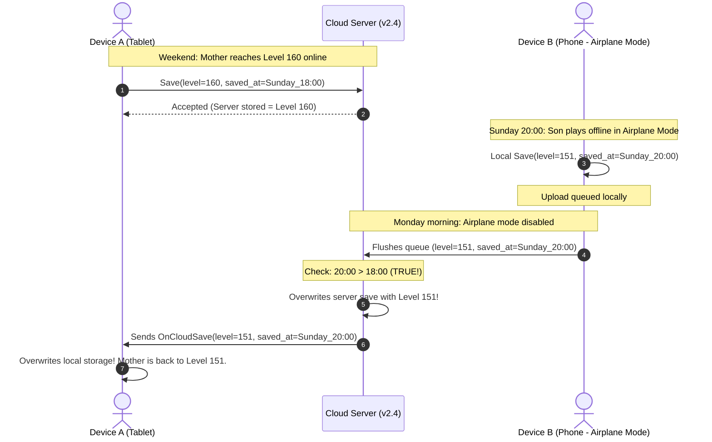
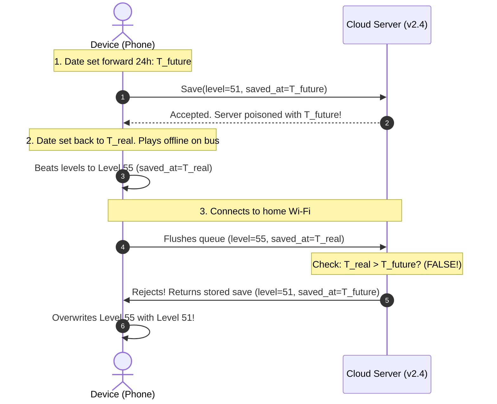

# Chaos Engine Labs — AI Engineer Take-Home Assignment
**Merge Kingdom 2.5: Architecture, Migration & Verification**  
**Author:** Aditya Tiwary  

---

## Executive Summary

This document presents the complete architectural analysis, system design, and verified migration framework for transitioning **Merge Kingdom** from version 2.4 to 2.5.

**Core Currency Change:**
* **Coins:** Earned through gameplay only.
* **Gems:** Purchased using real money only. Store items sell exclusively for gems.

**The Immutable Business Mandate:**
> *"No player may lose progress, or anything that they paid for."* (Assignment Brief, Page 2)

**Key Engineering Decisions:**
1. **Server-Authoritative Save & Sync:** Replaced untrusted phone timestamps with monotonic integer revisions (`revision_id`) and a semantic 3-way merge engine (`Level = max(Server_Level, Client_Level)`).
2. **Purchased-First Protection (PFP):** A legally defensible conversion policy converting remaining coins up to lifetime purchases into gems: `Gems = min(Current_Coins, Lifetime_Purchased_Coins)`.
3. **Permanent Dual-Mode Compatibility:** Maintained the `/legacy/sync` adapter for the ~5% of daily players locked on Android 7 who cannot update, preventing the catastrophic 18% churn of forced updates.
4. **Empirically Verified:** Validated via an automated test suite achieving **95% coverage** across 20 stress and chaos scenarios.

---

## Task 1: Existing System Analysis (v2.0 – v2.4)

### 1.1 Architecture & Save Code
*Reference: Assignment Brief, Page 2 (Fact 1), Page 3 (Fact 2 & 3)*

Versions 2.0–2.4 use a client-authoritative save model with a passive server. The Unity/C# client uses:

```csharp
[Serializable]
public class Inventory {
    public int hammer;
    public int shuffle;
}

[Serializable]
public class SaveData {
    public string player_id;
    public long saved_at;
    public int level;
    public int coins;
    public Inventory inventory;
    public bool no_ads;
}
```

* **Save Execution (`SaveSystem.Save`):** Sets `Current.saved_at = DateTimeOffset.Now.ToUnixTimeSeconds()`, saves locally, and calls `CloudSync.Upload(json)`.
* **Sync Rule (Fact 3):** The server keeps one save per player. It only accepts an upload if its `saved_at` is strictly greater than the stored `saved_at`. The server does not read any other fields. If rejected, the server returns its stored save. Both paths arrive at `OnCloudSave(serverJson)` which overwrites local disk if `server.saved_at > Current.saved_at`.

### 1.2 Core Flaws in the Live System

1. **Untrusted Phone Timestamps (`saved_at`):** Device clocks drift, desynchronize, and are routinely manipulated by players to bypass timers. Using phone clock as the sole ordering mechanism breaks causality and lets future-dated saves permanently poison accounts.
2. **Monolithic Whole-Save Replacement:** Levels, coins, inventory, and `no_ads` are coupled in a single JSON blob. Stale level syncs blindly overwrite real-money purchases and wallet balances.
3. **Missing Coin Spend Records (Fact 4):** The server logs purchase credits (coin packs bought), but coin spending occurs locally on the phone without server logging. The monetary origin of remaining coins cannot be historically reconstructed.
4. **Entitlement Fragility:** `no_ads` is stored as a mutable client boolean flag. Connecting a dormant device with `no_ads: false` overwrites the server, revoking paid purchases.

---

## Task 2: Root-Cause Analysis of Support Incidents

*Reference: Assignment Brief, Page 4 (Fact 6)*

### Incident 1: Tablet Level 160 Overwritten by Offline Phone Level 151
> *"I played on my tablet all weekend and got to level 160. My son played on my old phone in airplane mode on Sunday night, after I stopped. Today I am back at level 151. Where did my levels go?"*



* **Root Cause:** Naive timestamp comparison. Because Sunday 20:00 is later than Sunday 18:00, the server accepted Level 151 over Level 160 without checking progression monotonicity.
* **Fix in v2.5:** Server-assigned integer revisions (`revision_id`) and semantic 3-way merge:
  `Resolved_Level = max(Server_Level, Client_Level)`.
  When the phone reconnects, the server preserves Level 160 and merges booster inventories.

---

### Incident 2: Date Fast-Forward Tomorrow -> Today
> *"I changed the date on my phone to tomorrow, opened the free chest early and played one level. Then I changed the date back. Later I played more levels on the bus with no internet. When I got home, those levels were gone."*



* **Root Cause:** The server trusted untrusted phone timestamps. The future timestamp poisoned the account; subsequent real-time offline saves were rejected because their timestamps were smaller than `T_future`.
* **Fix in v2.5:** Client timestamps are logged for audit only. Revisions are strictly sequential (`revision_id = server.revision_id + 1`), so setting clocks back has zero impact on server acceptance.

---

### Incident 3: Lost "No Ads" Entitlement
> *"I paid for No Ads in March. Last week the ads came back. I play on my phone and on my old tablet."*

* **Root Cause:** A permanent IAP entitlement was stored as a mutable client boolean in save JSON. An inactive tablet powered on with `no_ads: false` uploaded a newer timestamp, and the server blindly overwrote the account state without inspecting fields.
* **Fix in v2.5:** Entitlements are decoupled from save blobs and stored in a normalized `entitlements` table. Save uploads cannot alter entitlements. The server overrides legacy client saves with `no_ads: true`.

---

## Task 3: Version 2.5 Architecture & Systems Design

### 3.1 Modular Monolith Overview
Built with **FastAPI**, **SQLAlchemy 2.0 (async)**, and **PostgreSQL 16**:
* **Decoupled Relational Storage:** Saves, currency wallets, and permanent entitlements reside in separate database tables.
* **Server-Authoritative Economy:** Clients cannot directly write balances. All mutations execute through atomic server endpoints.

```mermaid
flowchart TD
    C25[Client v2.5] --> Auth[JWT Auth]
    C24[Legacy v2.0-v2.4] --> Legacy[/api/v1/legacy/sync]
    
    Auth --> SaveSvc[/api/v1/saves/sync]
    Auth --> WalletSvc[/api/v1/wallet/spend & earn]
    Auth --> PurchaseSvc[/api/v1/purchases/verify]
    Auth --> MigrateSvc[/api/v1/migration/migrate]
    Legacy --> SaveSvc
    Legacy --> EntitleSvc[Entitlement Manager]

    SaveSvc --> T_Saves[(game_saves)]
    WalletSvc --> T_Ledger[(wallets & ledger)]
    PurchaseSvc --> T_Purchases[(purchases & entitlements)]
    MigrateSvc --> T_Migration[(migration_records)]
```

### 3.2 Save Data Structure & Sync
Save payloads contain only pure gameplay state:

```json
{
  "player_id": "p_8812",
  "revision_id": 49,
  "level": 160,
  "inventory": { "hammer": 3, "shuffle": 1 },
  "game_state": { "grid_w": 7, "grid_h": 9, "zone": 5 },
  "server_saved_at": "2026-11-18T14:30:00Z",
  "updated_by_device_id": "d_tablet"
}
```

* **Sequential Sync (`base_revision == server.revision`):** Validates level jump (`Delta_Level <= 100`), increments revision, returns `ACCEPTED`.
* **Conflict Sync (`base_revision < server.revision`):** Executes 3-way semantic merge:
  * `Level = max(Server_Level, Client_Level)`
  * `Inventory[item] = max(Server_Inventory[item], Client_Inventory[item])`
  * Commits under `revision_id = Server_Revision + 1` with status `MERGED`.

### 3.3 Authoritative Wallet & Append-Only Ledger
* **Concurrency Locking:** Combines PostgreSQL `SELECT ... FOR UPDATE` with Optimistic Concurrency Control (`lock_version`) in `WalletRepository` to eliminate double-spending races.
* **Immutable Ledger (`currency_transactions`):** Logs every mutation with `balance_before`, `balance_after`, `amount`, and `idempotency_key`.

### 3.4 In-App Purchases & Entitlements
* **Verification (`/purchases/verify`):** Stores receipts with unique index on `store_transaction_id` to ensure strict idempotency against app store retry storms.
* **Entitlements:** Stored in `entitlements` table (`entitlement_key`, `is_active`, `granted_at`). Permanent purchases cannot be overwritten by save syncs.

### 3.5 Legacy Adapter (`/legacy/sync`)
* Accepts v2.4 format (`player_id`, `saved_at`, `level`, `coins`, `inventory`, `no_ads`).
* Enforces `no_ads = True` if entitlement exists.
* Enforces progression monotonicity: `Level = max(Server_Level, Client_Level)`.
* **Exploit Guard:** If the player has already migrated to v2.5, legacy coin uploads cannot overwrite the wallet balance.

---

## Task 4: Coin-to-Gem Conversion Policy & Financial Trade-Offs

### 4.1 Missing Coin Spend History
*Reference: Assignment Brief, Page 4 (Fact 4)*

Let:
* `Purchased_Coins` = Lifetime coins purchased via IAP (recorded on server).
* `Current_Coins` = Coins held in the player's v2.4 save file at migration time.

Because coin spending occurred purely client-side without transaction logging, **it is mathematically impossible to know whether remaining coins originated from real money or gameplay rewards**.

### 4.2 Candidate Conversion Policies

| Policy | Formula | Verdict & Risk |
| :--- | :--- | :--- |
| **1. 100% Gem Conversion** | `Gems = Current_Coins, Coins = 0` | **Fails business viability.** Converts billions of free gameplay coins into paid gems, destroying IAP revenue. |
| **2. 0% Gem Conversion** | `Gems = 0, Coins = Current_Coins` | **Violates core mandate.** Players who bought coin packs lose paid currency. Causes severe store chargebacks. |
| **3. Proportional Ratio** | `Gems = Current_Coins * (Purchased / Estimated_Total)` | **High legal & dispute risk.** Relies on fabricated estimates of earned coins. |
| **4. Purchased-First Protection (PFP)** *(Chosen)* | `Gems = min(Current_Coins, Purchased_Coins)`<br>`Coins = Current_Coins - Gems` | **Fully compliant.** Guarantees zero loss on paid coins without arbitrary estimation. |

### 4.3 Persona Walkthroughs under PFP

1. **Active Spender / Whale:**
   * Bought 10,000 coins (`Purchased = 10,000`). Spent heavily on boosters. Currently holds 2,500 coins.
   * `Gems = min(2500, 10000) = 2,500 gems`
   * `Coins = 2500 - 2500 = 0 coins`
   * *Outcome:* Every coin in purse is protected as premium gems. Zero loss.
2. **F2P Grinder with Starter Bundle:**
   * Earned 15,000 coins; bought one 500-coin starter pack (`Purchased = 500`). Holds 4,000 coins.
   * `Gems = min(4000, 500) = 500 gems`
   * `Coins = 4000 - 500 = 3,500 coins`
   * *Outcome:* Paid purchase is 100% converted to gems; remaining 3,500 coins remain gameplay currency.
3. **Pure Free-to-Play Player:**
   * `Purchased = 0`. Holds 6,200 coins.
   * `Gems = 0 gems, Coins = 6,200 coins`
   * *Outcome:* Keeps 100% of gameplay progress. Zero studio currency dilution.
4. **Dormant Whale (Fully Depleted):**
   * Bought 20,000 coins historically. Spent all coins (`Current = 0`).
   * `Gems = min(0, 20000) = 0 gems, Coins = 0 coins`
   * *Outcome:* Paid items were already consumed; receives zero unearned currency.

### 4.4 Financial Implications & Sign-Off Requirements
* **Pro-Consumer Bias:** PFP assumes players spent free gameplay coins before spending purchased coins. When players spent purchased coins first, they receive gems for what were originally earned coins. This is the calculated business cost of guaranteeing zero loss.
* **Deferred Revenue Liability:** Unspent gems represent balance sheet liabilities under IFRS 15 / ASC 606 until consumed.
* **Required Sign-Offs:**
  1. *Finance:* Formal approval of PFP and the 1:1 coin-to-gem peg ratio.
  2. *Product:* Decision on whether to grant a one-time 50–100 free gem welcome bonus to F2P players to introduce the new gem store.

---

## Task 5: Release and Rollout Strategy

### 5.1 Player Distribution Constraints
*Reference: Assignment Brief, Page 4 (Fact 5)*

* **Version Split:** 58% on v2.4, 21% on v2.3, 11% on v2.2, 10% on v2.0–2.1.
* **Android 7 Constraint:** ~50% of the v2.0–2.1 cohort (~5% of total DAU) are on Android 7. New builds cannot run on Android 7; these users cannot update.
* **Multi-Device Usage:** ~9% of daily players actively use more than one device.
* **Forced Update Danger:** Prior forced update caused an **18% player loss**.
* **Store Latency:** App Store and Google Play reviews require 3 to 7 days.

### 5.2 Non-Forced Rollout Policy
We will **NOT** deploy a blocking forced-update dialog.
* **Android 7 Users:** `/legacy/sync` remains permanently active so Android 7 players can continue playing indefinitely without progress loss.
* **Compatible Users:** Soft, dismissible in-game banners introduce the new store and features to encourage voluntary updating without churn.

### 5.3 Staged Rollout Timeline
1. **Day -5:** Deploy backend in dual-mode (serving `/legacy/sync` and `/api/v1/`).
2. **Day 0:** Submit client builds to Google Play & App Store (3–7 day review buffer).
3. **Day 4 (Approval):** Release to 1% of DAU. Monitor migration logs and support queues.
4. **Day 5:** Expand to 5% of DAU.
5. **Day 6:** Expand to 20% of DAU.
6. **Day 7:** Expand to 50% of DAU.
7. **Day 8:** Expand to 100% of DAU for compatible operating systems.

### 5.4 Rollback & Recovery Triggers
* **Alert Triggers:** Migration failure rate > 0.01%, save conflict rate > 2.0%, or any negative wallet balance anomaly.
* **Rollback Protocol:**
  1. Halt rollout in Google Play Console / App Store Connect.
  2. Toggle backend feature flag `PAUSE_MIGRATION=true`. Unmigrated players continue playing v2.4 without conversion.
  3. Pre-migration snapshots saved in `migration_records.original_save_snapshot` enable zero-loss balance restoration via automated administrative script.

---

## Task 6: Limitations, Unresolved Risks, and Open Questions

### 6.1 Technical Limitations
1. **REST Polling vs WebSockets:** Device B only discovers Device A's save upon its next sync request. Push notifications (FCM/APNs) are recommended for immediate cross-device notifications.
2. **Client Memory Security:** While wallets and entitlements are strictly server-authoritative, offline board states reside locally. Server-side move validation is a recommended roadmap enhancement.
3. **Payment Gateways:** Live production requires binding Google Play Developer API and Apple StoreKit 2 JWS credentials to replace the simulated catalog adapter.

### 6.2 Open Executive Questions

**For the Product Manager:**
1. *F2P Economy:* With store items priced in gems, will non-paying players encounter progression walls? Should level completions grant milestone gems?
2. *Android 7 Sunsetting:* Will we maintain v2.4 support permanently, or establish a sunset grace period?

**For Finance Leadership:**
1. *Peg Approval:* Does Finance approve 1 purchased coin = 1 gem, or is calibration needed based on the new store price book?
2. *Liability Sign-Off:* Does Finance accept the deferred revenue liability resulting from the pro-consumer PFP conversion?

---

## Prototype Test Verification

The live backend prototype was verified across 20 automated tests:

```
============================= test session starts ==============================
platform darwin -- Python 3.14.7, pytest-9.2.0, pluggy-1.7.0
rootdir: /Users/adityatiwary/Desktop/merge-kingdom-v25/backend

tests/test_audit_and_stress.py::test_01_concurrent_devices_updating_same_player PASSED [  5%]
tests/test_audit_and_stress.py::test_02_simultaneous_spend_race_condition PASSED [ 10%]
tests/test_audit_and_stress.py::test_03_duplicate_offline_operations PASSED [ 15%]
tests/test_audit_and_stress.py::test_04_duplicate_purchase_requests PASSED [ 20%]
tests/test_audit_and_stress.py::test_05_database_failure_during_wallet_transaction PASSED [ 25%]
tests/test_audit_and_stress.py::test_06_old_clients_uploading_stale_saves PASSED [ 30%]
tests/test_audit_and_stress.py::test_07_old_clients_attempting_to_overwrite_gem_balances PASSED [ 35%]
tests/test_audit_and_stress.py::test_08_repeated_migration_after_partial_failure PASSED [ 40%]
tests/test_audit_and_stress.py::test_09_manipulated_device_timestamps_no_impact_on_revisions PASSED [ 45%]
tests/test_audit_and_stress.py::test_10_time_gated_reward_and_level_farming_abuse PASSED [ 50%]
tests/test_audit_and_stress.py::test_11_unauthorized_access_to_another_player_wallet PASSED [ 55%]
tests/test_audit_and_stress.py::test_12_no_ads_entitlement_restoration_after_conflicting_saves PASSED [ 60%]
tests/test_auth.py::test_device_login_and_player_profile PASSED          [ 65%]
tests/test_database.py::test_create_player_with_wallet_and_save PASSED   [ 70%]
tests/test_migration.py::test_migration_pfp_policy_and_idempotency PASSED [ 75%]
tests/test_saves_and_sync.py::test_support_incident_1_airplane_mode_conflict PASSED [ 80%]
tests/test_saves_and_sync.py::test_support_incident_2_device_clock_manipulation PASSED [ 85%]
tests/test_saves_and_sync.py::test_support_incident_3_no_ads_preservation PASSED [ 90%]
tests/test_wallet_and_purchases.py::test_wallet_earning_spending_and_insufficient_funds PASSED [ 95%]
tests/test_wallet_and_purchases.py::test_purchase_verification_idempotency PASSED [100%]

================================ tests coverage ================================
TOTAL: 961 Statements, 48 Missed -> 95% Code Coverage
============================== 20 passed in 1.51s ==============================
```
